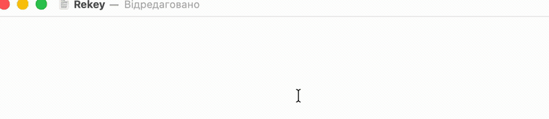

# Rekey

**لن تكتب بلغة خاطئة بعد اليوم.**

Rekey تطبيق مجاني لشريط القوائم في macOS، يلاحظ متى خرجت كلمة بتخطيط لوحة المفاتيح الخاطئ
فيعيد كتابتها في مكانها، ثم يبدّل التخطيط نيابةً عنك، فتواصل الكتابة وحسب. إنه أداة تبديل
تلقائي لتخطيط لوحة المفاتيح على Mac، وبديل أصلي لـ Punto Switcher وCaramba Switcher، من تطوير
[Taras Trishchuk](https://trishchuk.com/)، ومنشور على [trishchuk.com/rekey/ar](https://trishchuk.com/rekey/ar/).

*تسلسل مفاتيح واحد متصل، دون أي تحضير مسبق. `ghbdsn` المكتوبة بالتخطيط الإنجليزي تصبح `привіт`
ويتبدّل التخطيط إلى الأوكراني؛ و`Цщкдв` المكتوبة بالتخطيط الأوكراني تصبح `World` ويعود التخطيط
كما كان.*

## التنزيل

### [⬇ نزّل Rekey لنظام macOS](https://trishchuk.com/rekey/download/Rekey.dmg)

macOS 13 Ventura أو أحدث · إصدار شامل (Universal) واحد لـ Apple Silicon وIntel · مجاني

هذه نسخة تجريبية عامة. تُحدِّث نفسها تلقائيًا، وفي الإصدارات التجريبية ترسل افتراضيًا تقارير
أعطال مجهولة الهوية كي تُصلَح المشكلات فعلًا، ويمكن إيقاف الأمرين من الإعدادات.

## ماذا يفعل

- **يصحّح الكلمة دون أن يقطع تدفّقك.** حين تحصل كلمة على درجة أعلى بكثير في لغة أخرى منها في
  اللغة التي كتبتها بها، يحذفها Rekey ويبدّل التخطيط ويعيد كتابتها صحيحة. بلا نوافذ حوار، وبلا
  تأكيد.
- **عبارات كاملة، لا كلمات مفردة فقط.** الكلمة القصيرة التي لا يمكن الحكم عليها وحدها تنتظر حتى
  تحسم الكلمة التالية الأمر، فتتحوّل `f yt` إلى `а не` بدلًا من أن تبقى بلا تصحيح.
- **التراجع يعلّمه.** اضغط ⌘Z خلال خمس ثوانٍ من التصحيح فيضيف Rekey تلك الكلمة إلى قائمة
  التجاهل لديه. ولا يكرّر الخطأ نفسه في الكلمة نفسها مرتين.
- **والتبديل اليدوي أيضًا.** نقرتان على Shift افتراضيًا، أو Control أو Option أو Command أو
  ⌃Space أو ⌘Space أو ⌥⌘Space.
- **لا يعترض طريقك.** حقول كلمات المرور والطرفيات ومحررات الشيفرة مستثناة افتراضيًا، ويتخطّى
  النص الذي يبدو كعنوان URL أو مسار أو شيفرة.

## اللغات

34 لغة بأنظمة الكتابة اللاتينية والسيريلية واليونانية والعبرية والعربية والأرمنية والجورجية
والكورية، منها الأوكرانية والإنجليزية والألمانية والفرنسية والإسبانية والبولندية والتشيكية.
القائمة الكاملة في الإعدادات ▸ اللغات (Settings ▸ Languages).

الاكتشاف ليس جدول بحث: تُقيَّم كل كلمة وفق تكرارات أزواج الحروف وثلاثياتها في كل لغة إضافةً
إلى قاموس، وكلها مبنية من بيانات نصوص حقيقية لا من قائمة كلمات كتبها أحدهم يدويًا.

## Rekey مقارنةً بغيره

| | **Rekey** | Caramba Switcher | Punto Switcher |
|---|---|---|---|
| اللغات المدعومة | **34** | EN + RU | EN + RU |
| نصّك لا يغادر جهاز Mac أبدًا | ✓ | ✓ | ✕ |
| تصحيح جمل كاملة | ✓ | ✕ | ✕ |
| يحترم حقول كلمات المرور | ✓ | ✓ | ✕ |
| يستثني محررات الشيفرة افتراضيًا | ✓ | ✓ | ✕ |
| تراجع فوري (⌘Z) | ✓ | ✓ | ✕ |
| تطبيق Swift أصلي، بلا Electron | ✓ | ✓ | ✕ |
| مصمَّم لإصدارات macOS الحديثة | ✓ | ✓ | ✕ |
| السعر | **مجاني** | $6.99 سنويًا | مجاني |

المقارنة مبنية على معلومات متاحة للعموم، يونيو 2026.

## بديل Punto Switcher وCaramba Switcher لأجهزة Mac

تبحث عن **بديل لـ Punto Switcher على Mac**؟ هذا بالضبط ما هو عليه، إلا أنه صُمِّم لمن يكتبون
بأكثر من لغتين. Punto Switcher أداة من Yandex لنظام Windows، وإصداره القديم لأجهزة Mac لم يعد
يُصان ولا يعمل بشكل موثوق على Apple Silicon. أما Caramba Switcher فيعمل على إصدارات macOS
الحديثة، لكنه يركّز على الإنجليزية والروسية ويُباع باشتراك.

مقالات أوفى على الموقع:

- [Punto Switcher لأجهزة Mac — البديل الأصلي على macOS (Rekey)](https://trishchuk.com/rekey/ar/punto-switcher-li-mac/)
- [أفضل بدائل Punto Switcher لأجهزة Mac — مقارنة](https://trishchuk.com/rekey/ar/badail-punto-switcher/)
- [أفضل بدائل Caramba Switcher لأجهزة Mac — مقارنة](https://trishchuk.com/rekey/ar/badail-caramba-switcher/)
- مواجهة مباشرة (بالإنجليزية): [Rekey vs Caramba Switcher](https://trishchuk.com/rekey/compare/rekey-vs-caramba-switcher/) ·
  [Rekey vs Boomkey](https://trishchuk.com/rekey/compare/rekey-vs-boomkey/) ·
  [Rekey vs Keyboop](https://trishchuk.com/rekey/compare/rekey-vs-keyboop/) ·
  [Rekey vs MLSwitcher](https://trishchuk.com/rekey/compare/rekey-vs-mlswitcher/) ·
  [Rekey vs Flipio](https://trishchuk.com/rekey/compare/rekey-vs-flipio/)
- للقادمين من Windows (بالإنجليزية): [بديل Mahou](https://trishchuk.com/rekey/alternatives/mahou/) ·
  [بديل EveryLang](https://trishchuk.com/rekey/alternatives/everylang/)

## الأسئلة الشائعة

**هل يوجد Punto Switcher لأجهزة Mac؟**
ليس بإصدار حديث. إصدار Punto Switcher القديم لأجهزة Mac لم يعد يُصان ولا يعمل بشكل موثوق على
Apple Silicon. يؤدي Rekey المهمة نفسها، أي تصحيح النص المكتوب بالتخطيط الخاطئ وتبديل التخطيط،
بوصفه تطبيق Swift أصليًا لإصدارات macOS الحالية.

**هل Rekey مجاني؟**
نعم. مجاني، بلا حساب وبلا اشتراك. وهو حاليًا في مرحلة تجريبية عامة.

**هل يعمل على Apple Silicon؟**
نعم. إصدار شامل واحد يعمل على أجهزة Mac بمعالجات Apple Silicon وIntel مع macOS 13 Ventura أو
أحدث.

**ما اللغات التي يدعمها؟**
34 لغة، منها الأوكرانية والإنجليزية والألمانية والفرنسية والإسبانية والبولندية والتشيكية
واليونانية والعبرية والعربية. ويعمل مع أي زوج أو مجموعة من التخطيطات المثبّتة لديك، لا مع
الإنجليزية والروسية فقط.

**هل يرسل ما أكتبه إلى أي مكان؟**
لا. تُحلَّل كل كلمة على جهاز Mac. راجع قسم [الخصوصية](#الخصوصية) للاطلاع على القائمة القصيرة لما
يغادر الجهاز فعلًا.

**هل ما زال بإمكاني تبديل التخطيط يدويًا؟**
نعم. نقرتان على Shift افتراضيًا، أو اختر بدلًا من ذلك Control أو Option أو Command أو ⌃Space أو
⌘Space أو ⌥⌘Space.

## الخصوصية

تُحلَّل ضغطات مفاتيحك على جهاز Mac ولا تُرسَل أبدًا. لا حساب في Rekey، ولا مزامنة، ولا معالجة
للنص على أي خادم.

يمكن لأربعة أشياء أن تغادر الجهاز، ولا شيء غيرها:

1. **التحقق من التحديثات** — يسأل التطبيق الموقعَ إن كان هناك إصدار أحدث.
2. **إشعار تثبيت واحد** — رسالة واحدة عند إنهاء شاشة الترحيب، تسجّل الأذونات التي منحتها وما
   إذا كنت أكملت الإعداد. لا تحمل أي معرّف من أي نوع، ولا حتى معرّفًا عشوائيًا، فلا يمكن التمييز
   بين عمليات التثبيت ولا عدّها مرتين.
3. **تقارير الأعطال** — في الإصدارات التجريبية، مفعّلة افتراضيًا ويمكن إيقافها من الإعدادات.
4. **عنوان بريدك الإلكتروني** — فقط إن كتبته أثناء الإعداد وحدّدت مربع الاختيار.

النص الكامل: [سياسة الخصوصية (بالإنجليزية)](https://trishchuk.com/rekey/privacy.html).

## الملاحظات

مكان ملاحظات النسخة التجريبية هو [Issues](../../issues): تقارير الأخطاء، والتصحيحات الخاطئة،
واللغة التي تحصل على درجات سيئة. إن أفسد Rekey كلمة كان ينبغي أن يتركها كما هي، فهذا أنفع ما
يمكنك الإبلاغ عنه: اذكر الكلمة، والتخطيطين، والتطبيق الذي كنت تكتب فيه.

تشرح صفحة [كيف تبلّغ عن مشكلة](https://trishchuk.com/rekey/ar/feedback/) ما ينبغي تضمينه. تبدأ
كل Issue جديدة من أحد ثلاثة قوالب: **Bug report** (تقرير خطأ)، و**Language not detected well**
(اللغة لا تُكتشف جيدًا)، و**Idea or feedback** (فكرة أو ملاحظة). أما المشكلات الأمنية فتُبلَّغ
عبر تقرير خاص بدلًا من ذلك — راجع [SECURITY.md](SECURITY.md).

## عن هذا المستودع

Rekey ليس مفتوح المصدر حاليًا. يوجد هذا المستودع للإصدارات ولتتبّع المشكلات (Issues)، أما
الشيفرة المصدرية فموجودة في مكان آخر. التطبيق مجاني، ويُوزَّع كإصدار موقَّع وموثَّق (notarized)
مباشرةً من [trishchuk.com/rekey/ar](https://trishchuk.com/rekey/ar/).

ثمة تطبيقات أخرى تحمل اسم Rekey. هذا التطبيق من تطوير Taras Trishchuk، ولا يُنشر إلا على
[trishchuk.com/rekey/ar](https://trishchuk.com/rekey/ar/) وفي هذا المستودع.

---

[الموقع](https://trishchuk.com/rekey/ar/) · [الخصوصية (بالإنجليزية)](https://trishchuk.com/rekey/privacy.html)

[English](README.md) · [Українська](README.uk.md) · [Deutsch](README.de.md) · [Polski](README.pl.md) · [Español](README.es.md) · [Français](README.fr.md) · [Nederlands](README.nl.md) · [Ελληνικά](README.el.md) · [Türkçe](README.tr.md) · [עברית](README.he.md) · [العربية](README.ar.md)
